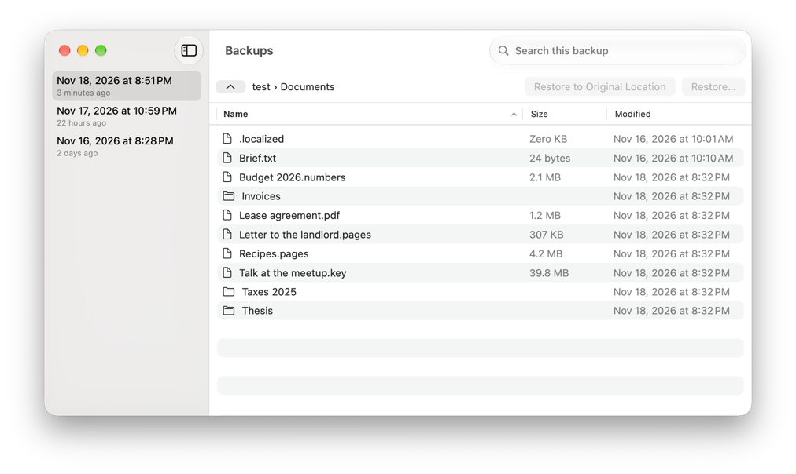
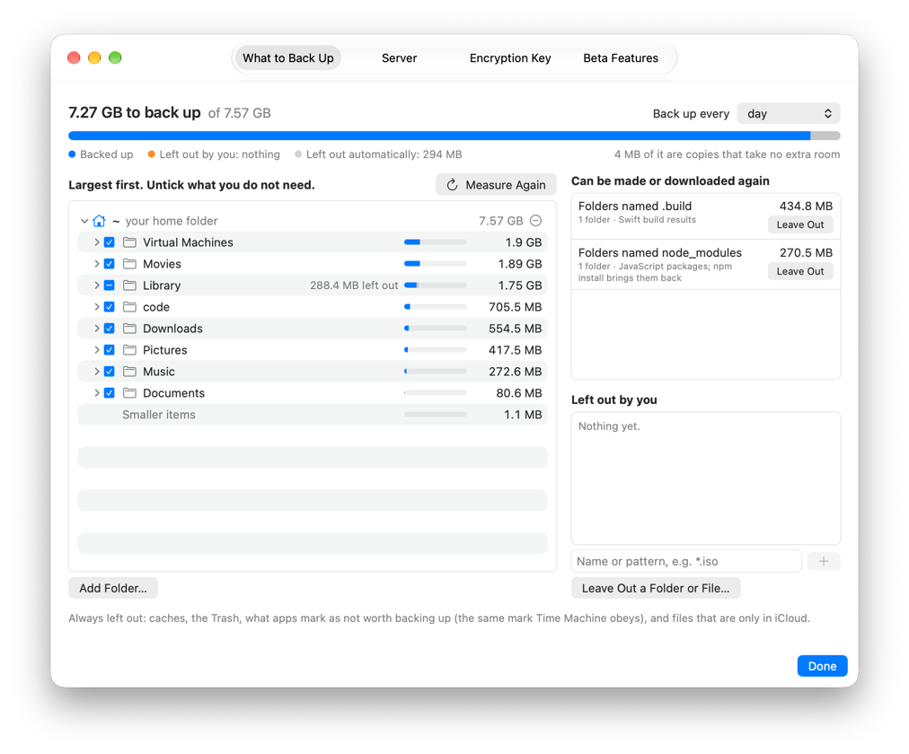

# PBS Mackup

Backs up a Mac's home folder to a [Proxmox Backup Server](https://www.proxmox.com/en/products/proxmox-backup-server/overview)
in the background. A menu bar app around a macOS build of `proxmox-backup-client`.

<picture>
  <source media="(prefers-color-scheme: dark)" srcset="docs/backups-dark.png">
  
</picture>

I had a PBS keeping history for everything else in the house and no way to put the laptop in
there. This is that.

It backs up your user folder, not the system. Getting a Mac back means: install macOS, install
this, restore.

- Encrypted on the Mac, read from a frozen APFS snapshot.
- Keeps Mac metadata: extended attributes, tags, resource forks, creation dates, ACLs. The
  file contents stay readable with the stock Linux client.
- After the first run it reads only the folders macOS reports as changed.
- Restores a few files from each new snapshot and compares them with the originals.

Caches, the Trash, files that only exist in iCloud and what apps mark as not worth backing up
are left out.

## Install

Apple silicon, macOS 26 or later, PBS 4.x.

```sh
brew tap 0x23me/tap
brew trust --cask 0x23me/tap/pbs-mackup
brew install --cask 0x23me/tap/pbs-mackup
```

Or take the zip from [releases](../../releases) and move the app to Applications.

## On the server

A namespace for the Mac, a user of its own, and a token of that user that can only add backups
there. On the PBS host, with your datastore's name for `store`:

```sh
proxmox-backup-debug api create /admin/datastore/store/namespace --name mac
proxmox-backup-manager user create mac@pbs
proxmox-backup-manager user generate-token mac@pbs backup
proxmox-backup-manager acl update /datastore/store/mac DatastoreBackup --auth-id 'mac@pbs'
proxmox-backup-manager acl update /datastore/store/mac DatastoreBackup --auth-id 'mac@pbs!backup'
```

The third command prints the token secret, once. The user has no password and gets the role
too, because a token never may more than its user. `DatastoreBackup` can't delete or prune, so
thinning out old snapshots is the server's job:

```sh
proxmox-backup-manager prune-job create mac-retention --store store --ns mac --schedule hourly \
  --keep-hourly 24 --keep-daily 30 --keep-weekly 52
proxmox-backup-manager verify-job create mac-verify --store store --ns mac --schedule daily \
  --ignore-verified true --outdated-after 30
```

A prune job without a namespace covers every namespace, this one included.

## Use

Settings has three tabs:

1. **Server.** Repository (`mac@pbs!backup@pbs.example.net:store`), namespace, a name
   for this Mac, the token secret.
2. **Encryption Key.** Make a key, then save the recovery file or print the paper key and keep
   it somewhere that isn't this Mac. Without the key or that copy nobody can read the backups,
   you included.
3. **What to Back Up.** Shows your home folder largest first, so you can untick what you don't
   need. Pick how often to back up.

Then switch on Full Disk Access for PBS Mackup in System Settings.

<picture>
  <source media="(prefers-color-scheme: dark)" srcset="docs/what-to-back-up-dark.png">
  
</picture>

The Backups window has snapshots on the left and folders on the right. Restore an item to a
folder you pick or to where it was. Right-click a file for its versions. Command-F searches the
names of the whole snapshot.

## More

- [Setting it up](docs/setup.md): each tab in detail, coming from an older version, removing it.
- [Getting things back](docs/restore.md): a whole Mac after losing it, Mac Settings (beta),
  restoring on Linux.
- [What is protected](docs/security.md), and from whom.
- [Reference](docs/reference.md): the parts, the files, the run tool, when a run reads everything.
- [Building](docs/building.md).

## State of things

Early. It runs on one Mac against one server, mine.

## Credits

- [Proxmox Backup Server](https://www.proxmox.com/en/products/proxmox-backup-server/overview)
  and its client, by Proxmox.
- Adam Okoń's [macOS port](https://github.com/adamokon/proxmox-backup-macos) of the client.
  The app carries a build of [0x23me/proxmox-backup-macos](https://github.com/0x23me/proxmox-backup-macos),
  branch `pbs-mackup`: that port plus what this app needed. The commit is in
  [client.commit](client.commit).

## License

BSD-3-Clause for the app. The client inside is AGPL-3.0; see [THIRD_PARTY.md](THIRD_PARTY.md).
