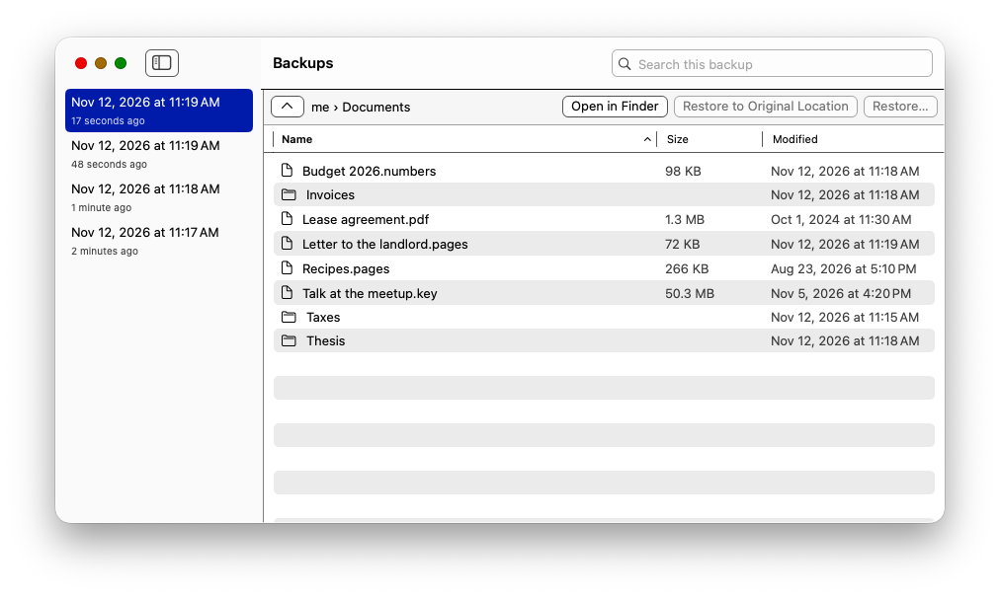
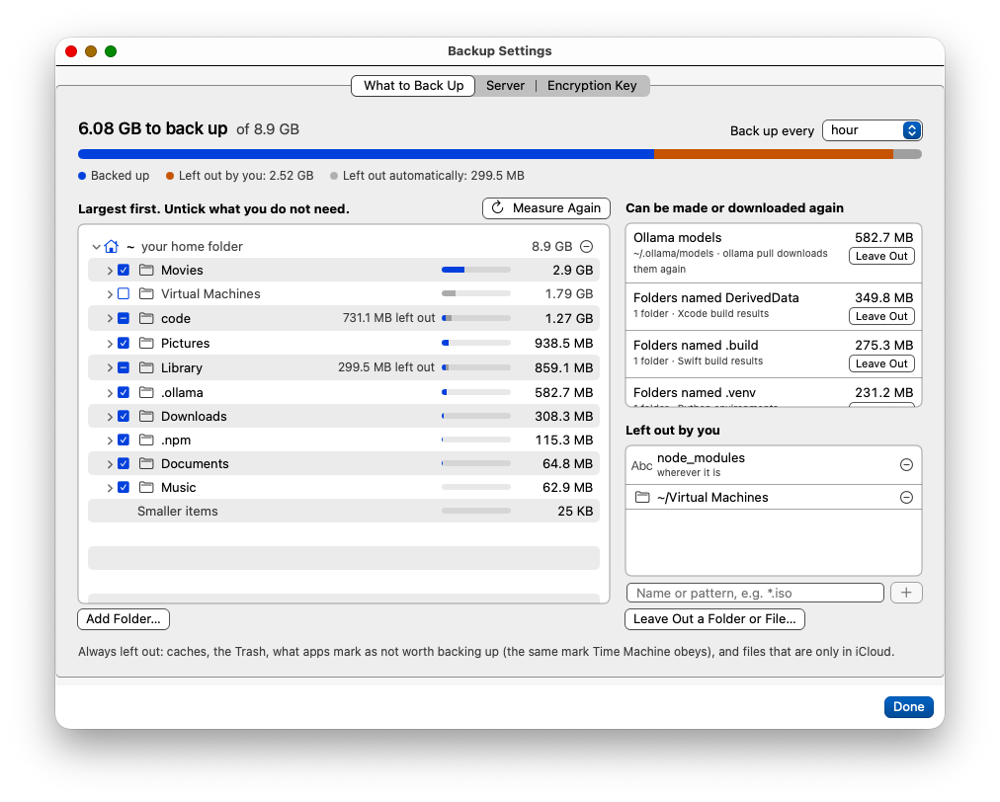

# pbs-mackup

Backs up a Mac's home folder to a [Proxmox Backup Server](https://www.proxmox.com/en/products/proxmox-backup-server/overview),
in the background, the way Time Machine does to a disk. It is a menu bar app around a macOS
build of `proxmox-backup-client`.

I had a PBS keeping history for everything else in the house and no way to put the laptop in
there. This is that.

It backs up your user folder, not the system. Getting a Mac back means: install macOS, install
this, restore. Not a Proxmox product; if something breaks, open an issue [here](../../issues).

- Encrypted on the Mac, read from a frozen APFS snapshot.
- Keeps Mac metadata: extended attributes, tags, resource forks, creation dates, ACLs. The
  file contents stay readable with the stock Linux client.
- After the first run it reads only the folders macOS reports as changed.
- Restores a few files from each new snapshot and compares them with the originals.
- Shows your home folder largest first, so you can untick what you don't need.
- Browse and search snapshots, see a file's versions, restore.

Caches, the Trash, files that only exist in iCloud and anything excluded from Time Machine
are left out.





## Install

Apple silicon, macOS 26 or later, PBS 4.x.

```sh
brew tap 0x23me/tap
brew trust --cask 0x23me/tap/pbs-mackup
brew install --cask 0x23me/tap/pbs-mackup
```

Or take the zip from [releases](../../releases) and move the app to Applications.

## On the server

A namespace for the Mac, a user of its own, and a token of that user that can only add backups
there. On the PBS host, with your datastore's name for `store`:

```sh
proxmox-backup-debug api create /admin/datastore/store/namespace --name mac
proxmox-backup-manager user create mac@pbs
proxmox-backup-manager user generate-token mac@pbs backup
proxmox-backup-manager acl update /datastore/store/mac DatastoreBackup --auth-id 'mac@pbs'
proxmox-backup-manager acl update /datastore/store/mac DatastoreBackup --auth-id 'mac@pbs!backup'
```

The third command prints the token secret, once. The user has no password and gets the role
too, because a token never may more than its user. `DatastoreBackup` can't delete or prune, so
thinning out old snapshots is the server's job:

```sh
proxmox-backup-manager prune-job create mac-retention --store store --ns mac --schedule hourly \
  --keep-hourly 24 --keep-daily 30 --keep-weekly 52
proxmox-backup-manager verify-job create mac-verify --store store --ns mac --schedule daily \
  --ignore-verified true --outdated-after 30
```

A prune job without a namespace covers every namespace, this one included.

## Setting it up

The app lives in the menu bar. Settings has three tabs:

1. **Server.** Repository (`mac@pbs!backup@pbs.example.net:store`), namespace, a name
   for this Mac, the token secret. A certificate the client can't check against the roots
   macOS ships shows its fingerprint to compare with the server's. That includes one from your
   own CA, even when your Keychain trusts it. Nothing is saved until the server has accepted
   the connection.
2. **Encryption Key.** Make a key, then save the recovery file or print the paper key and keep
   it somewhere that isn't this Mac. Without the key or that copy nobody can read the backups,
   you included. After a reinstall, import the copy. Saving the recovery file, printing the
   paper key and replacing the key ask for Touch ID or your password. A key file that has a
   passphrase asks for it once; the key is then stored without it, since a backup that runs by
   itself has nobody to ask. The file keeps its passphrase.
3. **What to Back Up.** Starts with your whole home folder. Untick folders, take the
   suggestions (`node_modules`, build folders, caches), or add a name (`*.iso`) or a path.
   Pick how often to back up. A folder has to be on the Mac's own disk, and two folders of the
   same name can't both be backed up. With more than one folder, a path you untick in one is
   left out of the others too.

Then switch on Full Disk Access for PBS Mackup in System Settings. Without it the app can't
mount a snapshot of the disk and reads the live folders instead, and such a run stops when a
file changes while it is read, which in a whole home folder is likely.

The token secret and the key are kept in your login Keychain; [what is protected](#what-is-protected)
says from whom.

### Coming from 0.1

0.2 keeps the token and the key in Keychain items of its own, which the run tool of the earlier
versions cannot read. When it first starts, macOS asks for your login password, once for each,
to move them there. Back Up Now, the Backups window and the settings work as before.

## Getting things back

The Backups window has snapshots on the left and folders on the right. Restore an item to a
folder you pick or to where it was; if something is already there you are asked first.
Right-click a file for its versions. Command-F searches the names of the whole snapshot.

### After losing the Mac

The whole home folder comes back on a freshly installed Mac, and you log in to it as before:
files, settings, the login keychain, and PBS Mackup with its settings and key.

1. Install macOS. In Setup Assistant, make your account with the same short name as before
   (`me`) and your old password, which the old login keychain opens with.
2. Install PBS Mackup and choose **Restore from a Backup…** in its menu. Turn on Full Disk
   Access and allow the restore helper, as the window asks; enter the server, the token and
   the recovery copy of the key.
3. **Find Backups** has an administrator allow the restore and picks the newest snapshot;
   **Restore…** starts it. You can keep working meanwhile, but what you save in this account
   until you log out is set aside.
4. When it says so, log out and log in again. The restored home folder is in place; **Finish**
   deletes the one from before and removes the helper.

The restore helper is the part of PBS Mackup that runs as root. It is only registered while you
restore, takes messages from the app alone, and does nothing without an administrator's password
or Touch ID. From a terminal, the same works with `sudo pbs-mackup-run restore-home me
'mac@pbs!backup@pbs.example.net:store' key.json --ns mac`, run from another administrator's
account while `me` is logged out.

With [Mac Settings](#mac-settings-beta) switched on, the app then offers to add your login items back.

Not in the backup and so not back: the apps (install them again), Full Disk Access and the other
permissions in Privacy & Security, background items apps register themselves (they come back
when you open the app), what is excluded from Time Machine, caches, and keychain items
that belong to the old Mac's hardware. iCloud Drive and other cloud storage are left out of the
restore; they sync again once you sign in. PBS Mackup's next run reads everything.

### Mac Settings (beta)

Your files are the backup. Some of a Mac's settings live outside the home folder, though, and a
restore of the files doesn't bring them back. **Mac Settings** records them with each backup. It
is a beta feature, off unless you switch it on under **Beta Features** in the settings; backing up and
restoring files works the same either way. So far it covers one thing: the apps in your "Open
at Login" list (System Settings > General > Login Items).

Choose a snapshot in the Backups window and click **Mac Settings…** to see them. An app that's installed is added back with **Add**, or all
of them with **Add All**; one that isn't says "install first", and becomes addable as soon as
you install it. After a home restore the app offers this once by itself. Whether an app opened
hidden isn't recorded: macOS ignores that setting.

Reading and adding login items goes through System Events, which macOS lets the app control
only once you agree. Allow it under **Record login items** in the Beta Features tab. Without it, backups go on without the list, and the screen says so.

### Without the Mac

On Linux, with the official `proxmox-backup-client` 4.x and the recovery copy of the key:

```sh
export PBS_REPOSITORY='mac@pbs!backup@pbs.example.net:store'
proxmox-backup-client snapshot list --ns mac
proxmox-backup-client restore host/my-mac/2026-11-12T08:00:00Z me.pxar /restore/target \
  --ns mac --keyfile key.json --ignore-xattrs true
```

With Mac Settings on, the recorded login items of a snapshot are in a small blob of their own:

```sh
proxmox-backup-client restore host/my-mac/2026-11-12T08:00:00Z settings.conf - \
  --ns mac --keyfile key.json
```

You get contents, names, permissions, dates and links, not the Mac-only metadata.
`--ignore-xattrs true` is needed because that metadata is stored in extended attributes
Linux refuses on symlinks.

## Reading only what changed

After the first backup a run asks macOS what changed since the last one (FSEvents, the log
Time Machine uses) and reads only those folders. It reads everything when the log has a gap
or the settings changed; the cases are in [docs/reference.md](docs/reference.md). Apple
calls the log advisory and recommends a full read now and then, so a run also reads
everything when the last full read is more than seven days ago. To read everything now:

```sh
/Applications/PBSMackup.app/Contents/MacOS/pbs-mackup-run --full
```

## Removing it

```sh
brew uninstall --cask pbs-mackup
rm -rf ~/Library/Application\ Support/pbs-mackup ~/Library/Caches/pbs-mackup \
  ~/Library/Group\ Containers/*.me.0x23.pbs-mackup
```

The key and the token stay in the login Keychain (under `me.0x23.pbs-mackup.tool`), the
backups on the server.

## What's inside

The client is built from [0x23me/proxmox-backup-macos](https://github.com/0x23me/proxmox-backup-macos),
branch `pbs-mackup`: Adam Okoń's [macOS port](https://github.com/adamokon/proxmox-backup-macos)
of the Proxmox Backup client plus what this app needed. The commit is in
[client.commit](client.commit).

Files and settings: [docs/reference.md](docs/reference.md). Building it:
[docs/building.md](docs/building.md).

## What is protected

- From the server and the network: everything is encrypted on the Mac with a key the server
  never sees, file names included. The token can add backups and fetch this Mac's own, still
  encrypted; it can't delete or prune.
- The backups and the key, from other programs on the Mac: macOS hands the token and the key
  only to the app's run tool, and the run tool takes requests only from the app, which macOS
  checks by its signature. Started by anything else, at a terminal say, it asks for Touch ID or
  your password before it lists or restores anything or changes the settings, the token or the
  key. It gives the key to nothing but the client it came with, checked by its signature too,
  and before it exports or replaces the key it asks even when it is the app that wants it.
- What is backed up and where to, from other programs: a run goes only by settings the app
  saved and by a key the app stored. It notes both in a folder where macOS asks you before it
  lets another developer's program in. When `config.json` or the key in the Keychain is not what
  was noted, nothing is backed up or read, and the menu says why.
- The frozen snapshot, which holds a copy of Mail, Messages and everything else in your home
  folder, and the files a run restores to check them: both are in that same folder.
- Not from a program that runs as you and only wants to be in the way. It can pause backups,
  delete the token and the key from the Keychain, or rewrite the state file. Backups then stop
  or fail and the menu says so; nothing gets out.
- Not what you are looking at: a file opened from the Backups window is an ordinary copy in the
  cache until the window closes.
- Not from the versions before 0.2 as long as their Keychain items exist: those handed the key
  to whoever asked. 0.2 moves the items out of their reach when it first starts. If an earlier
  version ran on a Mac you don't trust, make a new key.
- Not from anything that has Full Disk Access or is root, and not from a program you let in
  when macOS asks.

## State of things

Early. It runs on one Mac against one server, mine. Keep Time Machine on until you've
restored something you care about from here.

## License

BSD-3-Clause for the app. The client inside is AGPL-3.0; see [THIRD_PARTY.md](THIRD_PARTY.md).
