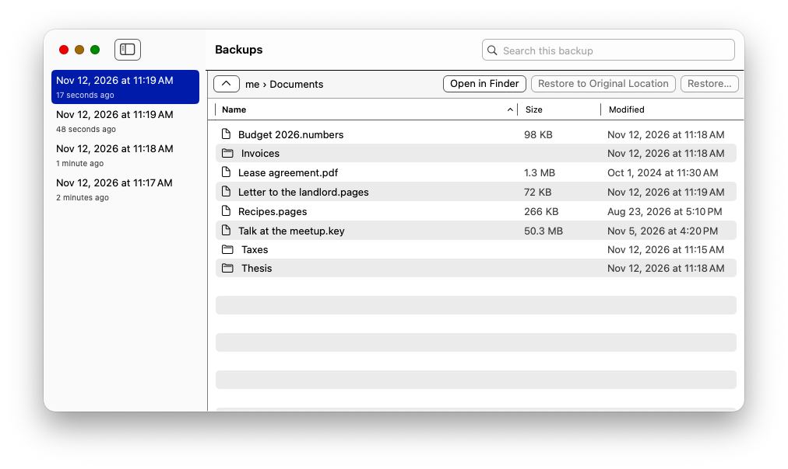
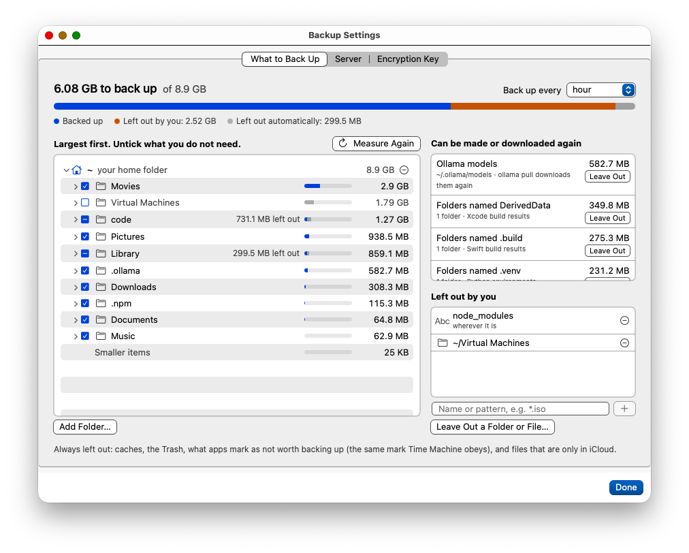

# pbs-mackup

Backs up a Mac's home folder to a [Proxmox Backup Server](https://www.proxmox.com/en/products/proxmox-backup-server/overview),
in the background, the way Time Machine does to a disk. It is a menu bar app around a macOS
build of `proxmox-backup-client`.

I had a PBS keeping history for everything else in the house and no way to put the laptop in
there. This is that.

It backs up your user folder, not the system. Getting a Mac back means: install macOS, install
this, restore. Not a Proxmox product; if something breaks, open an issue [here](../../issues).

- Encrypted on the Mac, read from a frozen APFS snapshot.
- Keeps Mac metadata: extended attributes, tags, resource forks, creation dates, ACLs. The
  file contents stay readable with the stock Linux client.
- After the first run it reads only the folders macOS reports as changed.
- Restores a few files from each new snapshot and compares them with the originals.
- Shows your home folder largest first, so you can untick what you don't need.
- Browse and search snapshots, see a file's versions, restore. With
  [FUSE-T](https://www.fuse-t.org), open a snapshot in Finder.

Caches, the Trash, files that only exist in iCloud and anything excluded from Time Machine
are left out.





## Install

Apple silicon, macOS 26 or later, PBS 4.x.

```sh
brew tap 0x23me/tap
brew trust --cask 0x23me/tap/pbs-mackup
brew install --cask 0x23me/tap/pbs-mackup
```

Or take the zip from [releases](../../releases) and move the app to Applications.

## On the server

A namespace for the Mac and a token that can only add backups there. On the PBS host, with
your datastore's name for `store`:

```sh
proxmox-backup-debug api create /admin/datastore/store/namespace --name mac
proxmox-backup-manager user generate-token root@pam macbackup
proxmox-backup-manager acl update /datastore/store/mac DatastoreBackup --auth-id 'root@pam!macbackup'
```

The second command prints the token secret, once. `DatastoreBackup` can't delete or prune, so
thinning out old snapshots is the server's job:

```sh
proxmox-backup-manager prune-job create mac-retention --store store --ns mac --schedule hourly \
  --keep-hourly 24 --keep-daily 30 --keep-weekly 52
proxmox-backup-manager verify-job create mac-verify --store store --ns mac --schedule daily \
  --ignore-verified true --outdated-after 30
```

A prune job without a namespace covers every namespace, this one included.

## Setting it up

The app lives in the menu bar. Settings has three tabs:

1. **Server.** Repository (`root@pam!macbackup@pbs.example.net:store`), namespace, a name
   for this Mac, the token secret. A certificate that isn't publicly trusted shows its
   fingerprint to compare with the server's.
2. **Encryption Key.** Make a key, then save the recovery file or print the paper key and
   keep it somewhere that isn't this Mac. Without the key or that copy nobody can read the
   backups, you included. After a reinstall, import the copy.
3. **What to Back Up.** Starts with your whole home folder. Untick folders, take the
   suggestions (`node_modules`, build folders, caches), or add a name (`*.iso`) or a path.
   Pick how often to back up.

Then switch on Full Disk Access for PBS Mackup in System Settings. Without it the app can't
mount a snapshot of the disk and reads the live folders instead.

The token secret and the key are kept in your login Keychain.

## Getting things back

The Backups window has snapshots on the left and folders on the right. Restore an item to a
folder you pick or to where it was; if something is already there you are asked first.
Right-click a file for its versions. Command-F searches the names of the whole snapshot.

Open in Finder needs FUSE-T (`brew install --cask fuse-t`). A mounted backup shows no Mac
metadata, so restore files rather than copying them out.

### Without the Mac

On Linux, with the official `proxmox-backup-client` 4.x and the recovery copy of the key:

```sh
export PBS_REPOSITORY='root@pam!macbackup@pbs.example.net:store'
proxmox-backup-client snapshot list --ns mac
proxmox-backup-client restore host/my-mac/2026-11-12T08:00:00Z me.pxar /restore/target \
  --ns mac --keyfile key.json --ignore-xattrs true
```

You get contents, names, permissions, dates and links, not the Mac-only metadata.
`--ignore-xattrs true` is needed because that metadata is stored in extended attributes
Linux refuses on symlinks.

## Reading only what changed

After the first backup a run asks macOS what changed since the last one (FSEvents, the log
Time Machine uses) and reads only those folders. It reads everything when the log has a gap
or the settings changed; the cases are in [docs/reference.md](docs/reference.md). Apple
calls the log advisory and recommends a full read now and then. There is no scheduled one
yet, so do it by hand:

```sh
/Applications/PBSMackup.app/Contents/MacOS/pbs-mackup-run --full
```

## Removing it

```sh
brew uninstall --cask pbs-mackup
rm -rf ~/Library/Application\ Support/pbs-mackup ~/Library/Caches/pbs-mackup
```

The key and the token stay in the login Keychain, the backups on the server.

## What's inside

The client is built from [0x23me/proxmox-backup-macos](https://github.com/0x23me/proxmox-backup-macos),
branch `pbs-mackup`: Adam Okoń's [macOS port](https://github.com/adamokon/proxmox-backup-macos)
of the Proxmox Backup client plus what this app needed. The commit is in
[client.commit](client.commit).

Files and settings: [docs/reference.md](docs/reference.md). Building it:
[docs/building.md](docs/building.md).

## State of things

Early. It runs on one Mac against one server, mine. Keep Time Machine on until you've
restored something you care about from here.

## License

BSD-3-Clause for the app. The client inside is AGPL-3.0; see [THIRD_PARTY.md](THIRD_PARTY.md).
